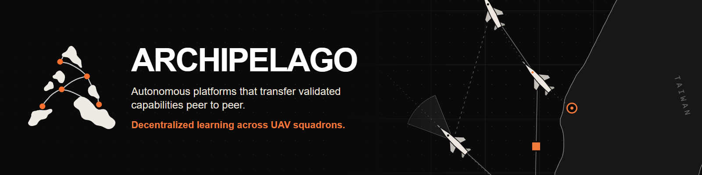
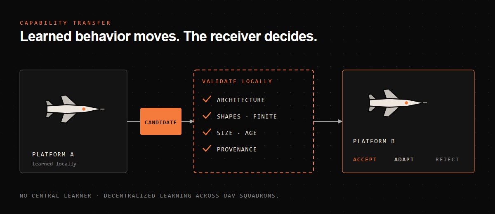
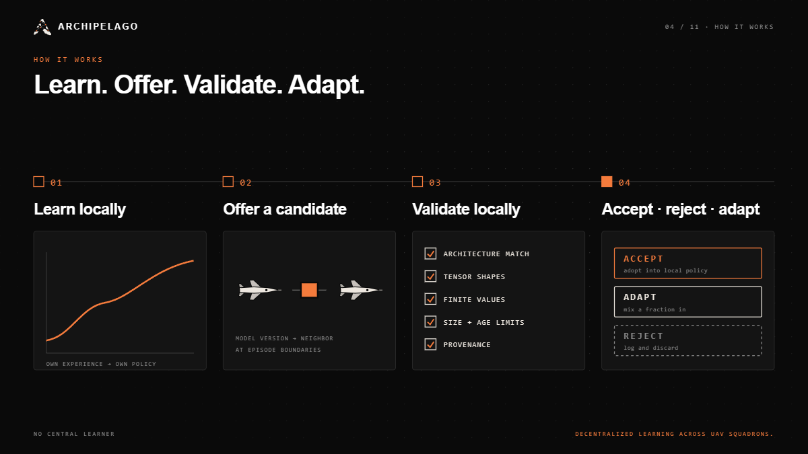
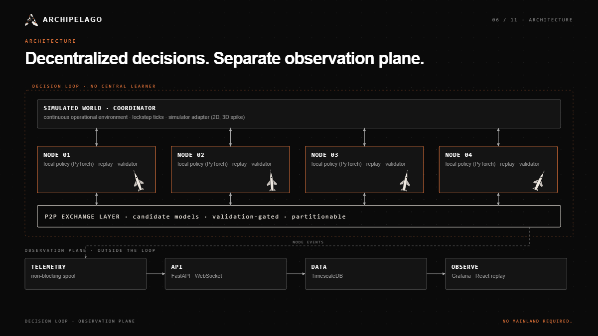
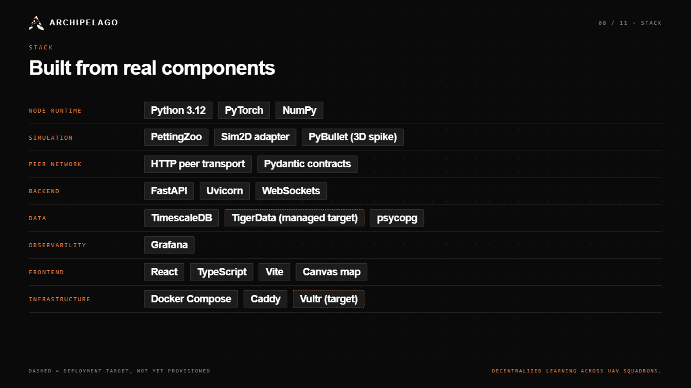

<div align="center">



<br />

**Decentralized learning for collaborative autonomous platforms.**
Nodes learn locally, share *learned capabilities* peer to peer, and validate them before adoption, with no central AI dependency.

<br />

[](https://github.com/Archipelago-Swarm/archipelago/actions/workflows/ci.yml)
[](https://devpost.com/software/archipelago-wpa5k9)
[](https://github.com/Archipelago-Swarm/archipelago/stargazers)
[](https://github.com/Archipelago-Swarm/archipelago/network/members)
[](https://github.com/Archipelago-Swarm/archipelago/issues)
[](https://github.com/Archipelago-Swarm/archipelago/commits/main)
[](#contributing)

[](pyproject.toml)
[](pyproject.toml)
[](services/api)
[](apps/web)
[](packages/storage)
[](observability)
[](infra/compose)
[](#current-status)

[Devpost](https://devpost.com/software/archipelago-wpa5k9) ·
[How it works](#how-it-works) ·
[Quick start](#quick-start) ·
[Architecture](#architecture) ·
[Current status](#current-status) ·
[Docs](#documentation)

</div>

---

## Table of contents

- [Why ARCHIPELAGO](#why-archipelago)
- [How it works](#how-it-works)
- [Features](#features)
- [Architecture](#architecture)
- [Operational scenario](#operational-scenario)
- [Quick start](#quick-start)
- [Tech stack](#tech-stack)
- [Repository layout](#repository-layout)
- [Current status](#current-status)
- [Roadmap](#roadmap)
- [Documentation](#documentation)
- [Contributing](#contributing)
- [Brand and media kit](#brand-and-media-kit)
- [License](#license)

## Why ARCHIPELAGO

Autonomous platforms in contested, communications-constrained environments cannot count on a link to a central model. Cloud-trained policies make edge systems **static consumers**: adaptation is slow, a single failure point exists, and useful behavior one platform learns does not reach the rest.

ARCHIPELAGO treats each platform as an **active learner**. The core idea:

> Share **learned capabilities**, not just observations. One platform learns something useful, another evaluates it locally, and can adopt it without repeating the full learning process.

The result is a layer where autonomous nodes adapt collectively, keep useful intelligence under node loss and network partitions, and continue operating without centralized AI infrastructure. The brand is aimed at defense and autonomy first (UAV squadrons), and the same framework applies to search and rescue, robotics and disaster response.

## How it works

<p align="center">
  
</p>

1. **Learn locally.** Each node trains its own policy on its own experience (own replay, own optimizer, own checkpoint).
2. **Offer a candidate.** At episode boundaries a node shares a model version with a neighbor over the peer network.
3. **Validate locally.** The receiver checks architecture, tensor shapes, finite values, size and age limits and provenance before anything changes behavior.
4. **Accept, adapt or reject.** An accepted candidate is mixed into the local policy; every decision is logged as telemetry.

Exchange honors network partitions: links can be cut, nodes keep acting locally, and offers resume when a link returns.

<p align="center">
  
</p>

## Features

| | |
|---|---|
| **Independent learners** | Per-node PyTorch policy, replay buffer and optimizer; no shared learner and no global checkpoint volume. |
| **Peer capability exchange** | Tensor-only, size-bounded payloads over an authenticated HTTP peer transport. |
| **Recipient-side validation** | Candidates are checked and scored by the receiver before adoption. |
| **Partition tolerance** | Application-level fault injection (link gates, loss, delay, bandwidth); nodes keep acting during a cut. |
| **Observability** | Non-blocking telemetry into TimescaleDB, Grafana dashboards, and a live React dashboard with replay. |
| **Simulator adapter** | A 2D world today, with a continuous-flight world and a PyBullet 3D adapter spike behind the same interface. |
| **Reproducible experiments** | Seeded runs, pre-registered studies and generated evidence under `experiments/`. |

## Architecture

<p align="center">
  
</p>

- **Decision loop:** a coordinator simulates the world (lockstep ticks); four node processes each act, learn and exchange. There is no central learner.
- **Observation plane:** telemetry flows to a FastAPI service, TimescaleDB, Grafana and the React dashboard. These sit outside the decision loop, so their failure does not stop a running experiment.

Details: [`agents/architecture/core.md`](agents/architecture/core.md), [`agents/architecture/live-runtime.md`](agents/architecture/live-runtime.md), [`agents/architecture/interfaces.md`](agents/architecture/interfaces.md).

## Operational scenario

The demo scenario puts UAV squadrons in a contested, communications-constrained Taiwan Strait style environment: links drop, platforms keep acting locally, and capabilities move when a link exists. The Remotion demo loop and the media kit use this scenario. All routes and topologies in marketing graphics are **illustrative**.

## Quick start

Prerequisites: [uv](https://docs.astral.sh/uv/), Node 22+, and Docker (for the full stack demo).

```bash
# Python workspace (dev tools). Live learners also need the torch group:
uv sync --frozen --group torch

# Web dashboard
npm install
npm run dev -w @archipelago/web

# Fast local gate (lint, format, ledger tests)
make check-fast

# Minutes, no Docker: types, contract drift, non-Docker pytest, web lint/test/build
make check-integration
```

One-command demo (needs a Docker daemon):

```bash
make demo                 # smoke plan: 150 ticks, partition at ticks 40-90
make demo PLAN=demo       # 900-tick scenario: cut at 300, rejoin at 600
```

The demo launches the coordinator, four nodes, API, web, proxy, Grafana and TimescaleDB, runs a plan, writes evidence to `artifacts/demo/<run_id>/` and tears the stack down. See [`infra/demo/README.md`](infra/demo/README.md).

> Dev-only secrets live in `infra/compose/local.env`. Never commit real credentials; deployments use `infra/compose/.env` (see `.env.example`).

## Tech stack

<p align="center">
  
</p>

Python 3.12, PyTorch, NumPy, PettingZoo, PyBullet (spike), FastAPI, Uvicorn, WebSockets, Pydantic, psycopg, TimescaleDB, Grafana, React, TypeScript, Vite, Canvas, Docker Compose and Caddy. **Vultr** and **TigerData** are the planned deployment targets and are not provisioned yet.

## Repository layout

```text
apps/web/              React + Canvas live dashboard
services/api/          run API, WebSocket stream, telemetry ingest
services/coordinator/  world + lockstep coordinator
packages/contracts/    versioned schemas, fixtures, generated TS types
packages/learning/     DQN learners, candidate validation and mixing
packages/node/         node runtime and peer endpoint
packages/transport/    peer messages, link gates, fault schedule
packages/sim/          PettingZoo world and flight world
packages/adapters/     simulator adapters (2D, PyBullet spike)
packages/storage/      SQL migrations and batched metric writes
experiments/           configs, seeds, studies and generated results
infra/                 Dockerfiles, Compose, proxy, Vultr tooling, demo driver
observability/         Grafana provisioning and dashboards
remotion/              demo video (Taiwan Strait capability-transfer loop)
brand-kit/             media kit: logos, Devpost and GitHub graphics
agents/                project vision, architecture, task ledger, handoffs
tests/                 contract, integration and failure-recovery tests
```

## Current status

ARCHIPELAGO is a **hackathon research prototype**. What the repository supports today (see [`agents/STATUS.yaml`](agents/STATUS.yaml) for the source of truth):

| Area | State |
|---|---|
| Live runtime: coordinator plus four PyTorch node processes, validation-gated peer exchange honoring partitions, checkpoint restore, telemetry | Merged on `main` |
| API with telemetry ingest and persistence, live dashboard, Compose stack and `make demo` driver | Merged on `main` |
| Variant study (T37), live adoption of the winning variant, local live pilot (T30) | Merged, results below |
| Vultr and TigerData deployment | **Not provisioned** |
| Clean-machine `make demo` and CPU-wheel node memory measurement | **Not yet verified** |

**What the evidence does and does not show** (no benchmark claims beyond this are made):

- Learning beats idle, random and untrained policies on frozen test seeds (paired CI excludes 0).
- Learning does **not** yet beat the rule-based explorer on return.
- In the live pilot, nodes make independent optimizer updates and no offers cross a cut link during the cut. Fleet versus isolated nodes is **not** yet shown to differ, so we do not claim that exchange improves learning.

Reports: [`experiments/out/T37/summary.md`](experiments/out/T37/summary.md), `experiments/out/T30/summary.md`.

## Roadmap

- [x] Continuous-flight world and pan/zoom map for the demo
- [x] Live decentralized runtime with partition-aware exchange
- [ ] Terrain: elevation, line of sight, cover
- [ ] Large-area operations
- [ ] Dynamic, seeded actors
- [ ] Richer candidate validation
- [ ] Persistent capability transfer under node attrition
- [ ] Vultr + TigerData deployment

## Documentation

| | |
|---|---|
| [Vision and roadmap](agents/vision/roadmap.md) | Product direction |
| [Core architecture](agents/architecture/core.md) | Boundaries and design decisions |
| [Live runtime](agents/architecture/live-runtime.md) | Processes, channels, amendments |
| [Evaluation design](agents/architecture/evaluation.md) | Experiment methodology |
| [Demo guide](infra/demo/README.md) | `make demo`, artifacts, configuration |
| [Vultr runbooks](infra/runbooks) | Deploy, smoke checks, rollback, budget guard |
| [Agent contract](agents/CONTRACT.md) | How coding agents work in this repo |

## Contributing

Pull requests are welcome. Please run `make check-fast` before pushing and `make check-integration` before requesting review, and say exactly what you did not run. Coding agents should start from [`CLAUDE.md`](CLAUDE.md) / [`AGENTS.md`](AGENTS.md); task state lives in [`agents/TASKS.yaml`](agents/TASKS.yaml) and changes only through `agents/controller.py`.

Do not commit credentials. Do not make claims in docs or graphics that experiments in this repository do not support.

## Brand and media kit

Logos, the Devpost thumbnail and slide templates, GitHub graphics and a brand guide are generated from code in [`brand-kit/`](brand-kit/) (`npm run render:graphics`, on demand, never run by CI). Exports live in [`brand-kit/exports/`](brand-kit/exports).

<p align="center">
  
</p>

## Star history

<a href="https://star-history.com/#Archipelago-Swarm/archipelago&Date">
  
</a>

## License

No license has been chosen yet, so all rights are reserved by default. A license decision is pending before any open-source release.

---

<div align="center">
<sub>ARCHIPELAGO · NO MAINLAND REQUIRED.</sub>
</div>
