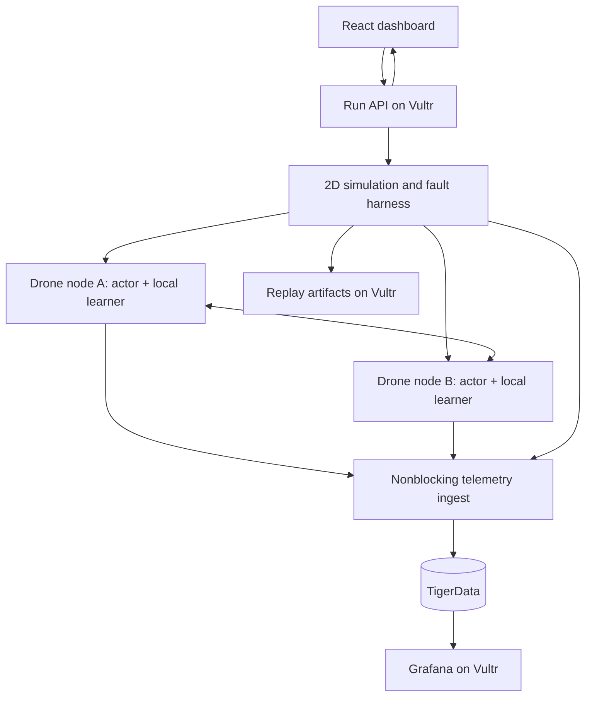

# Core architecture

These are implementation decisions, not a description of existing services. T01 converts the interfaces into executable schemas before fan-out.

## Two systems, two kinds of agents

Coding agents run on developer computers A and B, coordinate through GitHub, and write this project. Simulated drone nodes run inside the project. The coding-agent coordinator never becomes the swarm's central learner.



The simulator centrally computes world physics and step boundaries. This is an explicit simulation dependency, not a central policy or learner. Killing it stops the simulated world. Only the decision/learning/peer graph is decentralized. The API, database and dashboard are outside the decision loop; their failure must not stop an already-running experiment.

## Monorepo layout to implement

```text
apps/web/                      React + Canvas dashboard
services/api/                  run management, WebSocket, telemetry ingest
packages/contracts/            versioned schemas, fixtures, generated TS types
packages/sim/                  PettingZoo world and simulation coordinator
packages/node/                 actor, local memory, trainer, checkpoint lifecycle
packages/transport/            neighbor gating, peer messages, fault schedule
packages/learning/             DQN, baselines, candidate validation/mixing
packages/storage/              SQL migrations and batched metric writes
packages/adapters/             simulator protocol, 2D implementation, 3D spike
experiments/                   configs, seed manifests, benchmark/report scripts
infra/                         Dockerfiles, Compose, proxy and Vultr runbooks
observability/                 Grafana provisioning and dashboards
tools/agents/                  supervisor, ledger client and recovery helpers
tests/                         contract, integration and failure-recovery tests
agents/                        vision, architecture, tasks and durable handoffs
```

Start with a Python workspace and one web package. Avoid separate packages for trivial files. Exact dependency versions and image digests must be resolved, locked, and tested by T01/T10; version names in the roadmap are baseline choices, not claims of current latest releases.

## World and execution

Initial world: 64 x 64 cells, local 11 x 11 observations, static obstacles, rescue markers, finite energy, and five discrete actions (stay/north/east/south/west). Use 4 nodes by default; 8 nodes next; 16/32 only after profiling. Coordinates use meters and right-handed ENU (x east, y north, z up); 2D fixes z=0. Separate simulation time from wall time.

Training mode is lockstep and seeded. The harness gathers each active node's action for tick t, resolves simultaneous motion/collisions deterministically, then delivers only that node's observation/reward. Seed RNG streams separately for environment, topology, learner and exploration. Node ordering must not change outcomes. Evaluation freezes optimizer and exploration unless explicitly measuring online adaptation.

Distributed demo mode has a configurable action deadline (initial target 500 ms). Missing actions become stay actions and emit deadline events; a missed deadline cannot silently remove a node. Repeated misses trigger a declared unavailable state. Policy inference must not block on training, metrics or peer exchange. Report nondeterminism from process scheduling; exact replay uses recorded actions/events, not a claim of bit-identical distributed training.

## Per-drone node

Each node owns a distinct policy, target network, optimizer, bounded replay buffer, sensor history, peer cache, RNG state and checkpoint directory. Initial weights may come from the same immutable seed file, copied separately. A node may read only its observation slice and permitted neighbor messages. It must not read the simulator's full state, another node's replay files, or a global checkpoint volume.

Local DQN is the first learning path because actions are discrete. Begin with a small MLP over an encoded local crop, local exploration memory, energy, and a bounded peer summary. Record architecture/encoder/reward identifiers. Keep a rule-based explorer and independent DQN baseline runnable at all times.

Use separate execution paths for acting and training. Publish a new immutable inference snapshot at a tick/episode boundary. Store/checkpoint replay in bounded numeric arrays/files, not another database. Allocate buffer length from measured RAM rather than a large default.

## Peer learning experiment

For the first experiment use same-architecture, same-initialization, same-reward learners. At episode boundaries, advertise model metadata; optionally request one neighbor's bounded tensor payload. Transfer tensor-only data using a format such as safetensors; never deserialize peer-supplied pickle or executable code.

A baseline candidate is `candidate = (1-alpha) * local + alpha * peer`, initially alpha=0.1. This is an experimental heuristic: independently trained networks can become incompatible even when tensor shapes match. Validate architecture/encoder/reward hashes, tensor names/shapes, finite values, byte limits, age and provenance before considering it.

Evaluate candidate and current policy on the same fixed, local validation set, with no optimizer updates. Accept only under a predeclared score tolerance and collision bound; otherwise reject and log the reason. This set is separate from final benchmark seeds and must not expose another node's hidden state. On acceptance, synchronize the target network and reset optimizer moments according to a fixed documented rule; preserve local replay. Checkpoint the old model for rollback. Log validation cost as compute overhead.

Limit gossip to one candidate per node per exchange interval, bounded neighbors and bytes/second. Dedupe by sender/version/hash. After reconnection, request the latest compatible version; do not replay the whole backlog. Keep parameter averaging as an ablation. Distillation and graph neural message passing are later tasks if mixing is unstable; their algorithms and extra training cost need separate evaluation.

## Transport and partition model

Direct node-to-node HTTP endpoints on the private Compose network provide the initial transport. A shared immutable seeded topology schedule is supplied to every node; each receiver and sender enforces allowed directed links, delay, loss and bandwidth. The topology module provides the same interface in in-process tests. No central broker carries learning messages.

This first fault model simulates communication outages at the application layer. The physics observation/action channel and telemetry are distinct and remain available. Clearly label it as such. Later Linux network-namespace/netem tests can validate real socket failures; passing application fault tests is not proof of radio behavior or failure of an entire physical host.

Discovery starts from a static node manifest; range and fault schedule determine allowed neighbors. Enforce request timeout, bounded queue, payload size, retry cap and backoff. Peer endpoints are private and authenticated. Add TLS/mTLS when peers span hosts. Telemetry outages drop or spool bounded data, never block inference.

## Persistence and observation

TigerData stores run metadata, schema/commit/config hashes, node metrics, experiment events and artifact manifests. Use Timescale hypertables for timestamped node metrics, ordinary relational tables for runs and artifacts. Preserve both `sim_tick` and UTC event time. Use a deterministic event ID and unique key including the hypertable time column where required, so retries are idempotent. Use batched inserts, bounded spool, retry backoff and explicit dropped-event counters.

Grafana connects with its own read-only database role. The web UI calls the API and never receives database credentials. Large tensors/replays belong in per-node mounted storage initially, then Vultr Object Storage; TigerData records their paths and hashes. A database outage must not grant the node access to anyone else's state.

Start with one allowed active run and one API process to simplify ownership. Return 409 for conflicting starts. Increasing run concurrency requires an explicit scheduler and resource admission policy.

## Deployable shape

Compose services: reverse proxy, web static assets, API, simulation coordinator, node-01 through node-04, Grafana; local profile also runs TimescaleDB. Production uses TigerData's TLS connection and excludes the local DB service. Configure CPU/RAM limits and node thread counts. Only HTTPS is public; SSH is restricted; database, Grafana administration and peer endpoints are not anonymously exposed.

Use an existing approved Vultr instance or obtain an explicit operator budget before provisioning. Deploy immutable commit-tagged images, migrations, health/readiness checks and persistent volumes. Verify the previous image can be restored without destructive schema rollback. Save a smoke-tested URL, image identifiers and rollback procedure in the deployment handoff.

## 3D path

Keep mission state, telemetry and policy interfaces independent of renderer and physics. `SimulatorAdapter` supplies capabilities, reset, per-node observe, joint step, snapshot and close. Its action semantics identify discrete grid moves versus velocity/waypoint commands. Map the 2D action to a waypoint through an adapter; a 3D low-level controller tracks that waypoint.

First evaluate a pinned gym-pybullet-drones revision in its own Docker image: headless 2-4 drone takeoff/waypoint/landing with collision metrics. It provides Python-oriented drone physics examples but does not supply Archipelago's learning protocol. Preserve upstream license notices and record runtime compatibility/build requirements.

Later add Gazebo/PX4 SITL for flight-stack fidelity. Separate observation/action encoders and new policy versions are expected; reject cross-encoder weight exchange. Three.js is an optional renderer consuming pose telemetry, not the physics engine. Do not pull a large simulator dependency into every 2D CI job.
